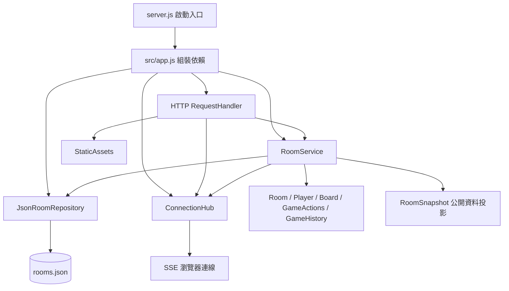
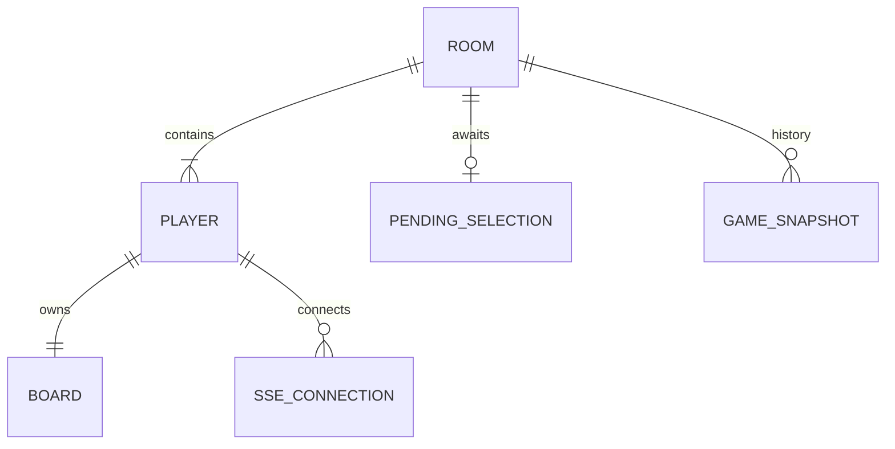
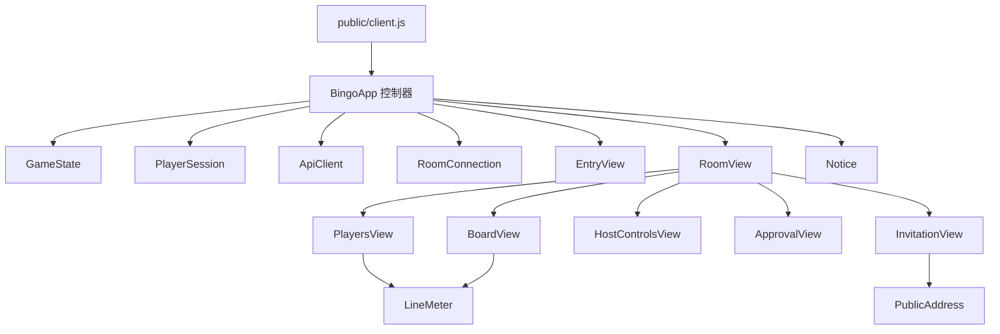

# Alberta Events 架構與物件關係

程式保留原本的 REST API、SSE 格式與 `data/rooms.json` 存檔格式。前端使用瀏覽器原生 ES modules，後端使用 CommonJS；不需建置工具或第三方套件。

## 後端：依賴方向

| 模組 | 職責 | 不負責的事 |
|---|---|---|
| `src/app.js` | 建立單一應用程式及其依賴，可注入測試用 repository | 遊戲規則 |
| `http/request-handler.js` | 路由、請求大小與來源檢查、HTTP 錯誤、SSE 生命週期 | 勝負與回合 |
| `application/room-service.js` | 組織加入／恢復身分、權限驗證、重送去重、執行規則後存檔並廣播 | 操作 DOM、直接讀寫檔案 |
| `application/room-snapshot.js` | 產生公開遊戲資料，排除憑證與操作紀錄 | 修改房間 |
| `domain/room.js`、`player.js` | 建立資料、玩家加入、身分驗證與加入順序 | HTTP 與檔案 |
| `domain/board.js` | 建立與驗證 N×N 盤面、計算橫直斜連線 | 玩家身分與網路 |
| `domain/game-actions.js` | 尺寸、準備、開始、選號、審核、略過、重開局 | 存檔與廣播 |
| `domain/game-history.js` | 建立快照、撤回、舊存檔回到開局的相容行為 | 玩家連線 |
| `infrastructure/json-room-repository.js` | 持有房間集合、讀檔、暫存檔替換寫入 | 遊戲規則 |
| `infrastructure/connection-hub.js` | 每位玩家的多條連線、在線狀態、心跳與事件傳送 | 持久化遊戲狀態 |

`RoomService` 只依賴 repository 的 `get/all/add/save` 和連線物件的 `isOnline/broadcast`，不綁定檔案系統。Domain 不匯入 HTTP、application 或 infrastructure。每次 `createApplication()` 都建立獨立依賴，測試不必共享全域房間集合。

## 遊戲資料關係

- `Room.players` 的陣列順序決定選號順序。畫面排名只對副本排序，不能改寫此陣列。
- `Player.name` 是玩家輸入的房間內 ID；`Player.id` 是內部 UUID。`Room.host`、`Room.turn`、`pending.playerId`、`winners` 都參照 UUID，避免名字顯示與排名影響規則。
- `Player.token` 用於後續 API／SSE 驗證，只在建立或恢復該玩家時回傳。公開快照不包含它。
- `Room.called` 是房主確認過的號碼。`pending` 尚未計分；確認後才加入 `called`。拒絕只推進回合。
- `GameSnapshot` 只保存回合與遊戲進度，不複製玩家憑證、盤面或在線狀態。尺寸只能在 lobby 修改並清除歷史。
- `Player.requests` 保留成功操作 ID；重送回傳現況，不重複修改。`Room.revision` 單調遞增，不隨撤回倒退。
- 在線狀態來自 `ConnectionHub`，不寫入存檔；同玩家任一分頁仍連線即視為在線。

## 前端：物件組合

- `BingoApp` 把使用者意圖轉成 API 操作，再把快照交給 `GameState`；它不產生玩家卡片或格子。
- `GameState` 持有伺服器快照及本地草稿、所查看玩家、忙碌／連線狀態。拒絕較舊 revision；尺寸版本更新才丟棄舊草稿。它不操作 DOM 或儲存空間。
- `PlayerSession` 封裝分頁身分與舊版 localStorage 遷移；`PublicAddress` 只管邀請網址。玩家憑證不混入分享連結。
- `ApiClient` 封裝逾時與重試，一次操作的 payload 和 requestId 只建立一次。
- `RoomConnection` 管理 SSE 與重連回呼。關閉或換房後，舊連線的延遲事件不能再改變新房間。
- View 只讀 state，透過注入的 action callbacks 回報選號、編輯、設定或切換玩家，不直接呼叫 API。`BoardView` 和 `PlayersView` 共用無狀態的 `lineMeter()`。
- `RoomView` 是畫面組合層；每個子元件管理自己的 DOM 區域與短暫顯示狀態，例如清單捲動位置或對話框。

## 一次選號的資料流

1. `BoardView` → `actions.call(number)` → `BingoApp` → `ApiClient`。
2. HTTP handler 解析請求，交給 `RoomService.execute()`。
3. Service 驗證玩家及重送識別碼，`GameActions` 檢查回合並建立 `pending`；`GameHistory` 保存前一狀態。
4. Repository 寫入存檔，Service 產生公開快照，ConnectionHub 廣播。
5. 每個瀏覽器的 RoomConnection 收到快照，GameState 接受較新狀態，RoomView 更新子元件。
6. 房主的 ApprovalView 顯示待確認號碼，確認／拒絕走相同資料流。

## 修改功能時的入口

- 調整連線與勝負：`domain/board.js`、`domain/game-actions.js`。
- 改變玩家清單、排序或捲動：`public/js/views/players-view.js`。
- 改盤面輸入與格子顯示：`public/js/views/board-view.js`。
- 調整 API 重試／SSE：`public/js/network/`。
- 更換持久儲存：新增 repository 並由 `src/app.js` 注入，保留 repository 合約。
- 新增操作：加入 domain handler，控制器提供 action，對應 View 綁定事件，再補行為測試。

目前仍為單程序 JSON 存檔架構。這次是職責拆分，沒有加入帳號密碼或多程序同步，也沒有改變「同房號＋同玩家 ID 即恢復原身分」的規則。
