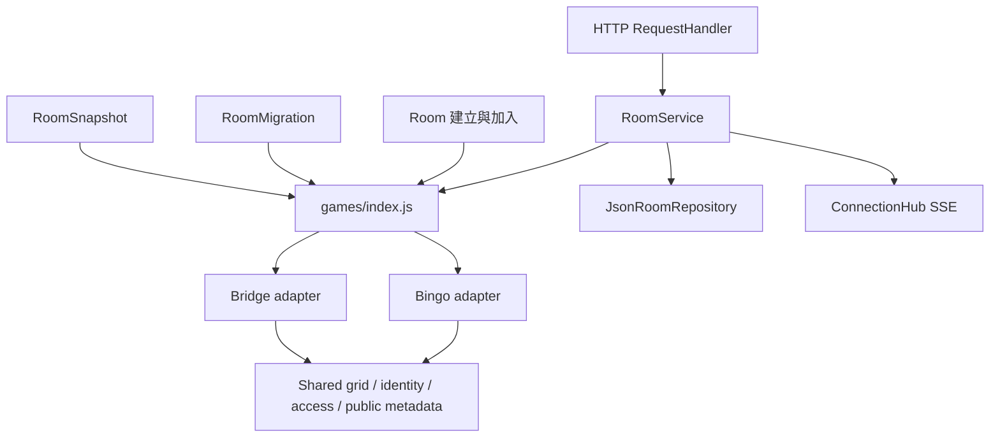

# Alberta Events 架構與遊戲模組

後端使用 CommonJS，前端使用原生 ES modules，沒有新增第三方依賴。Bingo 與 Bridge Bingo 各自擁有規則、資料初始化、遷移、公開快照、controller、state、view 與樣式；跨遊戲共用的程式不包含任一遊戲的回合或卡牌規則。

## 目錄與責任

```text
src/
  application/          RoomService、快照分派
  domain/               房間身分、成員驗證、房主權限、遷移分派
  games/
    index.js            遊戲註冊與查找
    bingo/              選號、抽卡問答、獎品、撤回、盤面與 Bingo 快照
    bridge/             分隊、三色數字牌、跟色、同步輪次與 Bridge 快照
  shared/               數字格線、連線計算、公開房間與玩家基本資訊
  infrastructure/       JSON 存檔、SSE 連線與在線狀態
  http/                 API、靜態檔案與輸入／來源檢查
public/
  js/
    app.js              GameApp：身分、進入／離開房間、API 與 SSE
    games/
      index.js          前端遊戲工廠
      bingo/            BingoController、BingoState、BingoView 與子視圖
      bridge/           BridgeController、BridgeRoomView、BridgeBoardView
    state/              共用 GameState，不含盤面草稿
    views/              RoomView 外殼、登入、邀請、DOM、dialog、連線圖形
    network/            ApiClient、RoomConnection
    storage/            PlayerSession、PublicAddress
  styles/               共用基本樣式、黑板視覺與建房表單
  games/bingo/          Bingo 卡牌與遊戲樣式
  games/bridge/         Bridge Bingo 遊戲樣式
```

## 後端依賴方向



`src/games/index.js` 註冊每種遊戲。共用的 RoomService、Room 與 repository 不依遊戲名稱分支執行規則。各 adapter 的合約為：

| 方法 | 責任 |
|---|---|
| `initializeRoom()` | 建立該遊戲專屬房間資料 |
| `createPlayer(room, name, token)` | 在共用身分上附加該遊戲的玩家資料 |
| `capacity(room)` | 決定可加入人數 |
| `joined(room, player)` | 新玩家加入後的遊戲內處理 |
| `restorePlayer(room, player)` | 重連時恢復參與；回傳是否需要存檔 |
| `applyAction(room, player, data, presence)` | 驗證並執行該遊戲支援的操作 |
| `snapshot(room, presence, viewerId)` | 投影公開資訊與本人可見的私密資訊 |
| `migrate(room)` | 相容該遊戲的舊存檔 |

RoomService 共用身分驗證、requestId 去重、revision 遞增、存檔及廣播。遊戲內不匯入 HTTP、RoomService 或另一遊戲的程式碼。

## 資料隔離與相容性

- 共用房間基本資訊包含房號、gameType、成員、房主、phase、revision；共用玩家身分包含 UUID、token、名稱與已受理的 requestId。
- Bingo 的盤面、cells、hand、選號、問答卡、獎品及撤回紀錄由 `src/games/bingo/` 管理，保留既有存檔欄位，以避免既有進度失效。
- Bridge 的盤面排列、配色、各隊佔領格、私人手牌與輪次保存在 `room.bridge`；成員只另有分隊與準備資訊。新建 Bridge 房間不初始化 Bingo 的 cells、問答卡、獎品或歷史。
- Bridge 快照不再提供只供 Bingo 使用的空 `called`、`board` 或玩家 `lines` 欄位。每種遊戲各自決定可公開的資料，共用 `public-room.js` 僅提供不含憑證的基本資訊。
- 舊房間未記錄 gameType 時仍預設為 Bingo。遷移依 gameType 分派；有效的 Bridge 進度不會經過 Bingo 遷移，舊 Bridge 空白頁房間仍可補上初始設定。
- `server.js` 保留原有測試／啟動入口的 Bingo helper exports 作相容用途；房間服務不透過這些 helper 分派遊戲。

## 前端生命週期

GameApp 只處理登入、建立／加入、進出房間、API、重試與 SSE。遊戲選擇由 `public/js/games/index.js` 提供 state、controller、view 與路徑工廠。

- 共用 GameState 只保存目前房間、玩家身分、連線與忙碌狀態，以及本人手牌的讀取；不假設每位玩家都有 Bingo board。
- BingoState 擴充 GameState，擁有草稿、輸入、尺寸設定與 dirty flags；換成 Bridge 時會建立新的共用狀態，不攜帶編輯資料。
- BingoController 提供選號、準備、抽卡問答、撤回、獎品通知等操作。
- BridgeController 只提供 Bridge 命令，選牌與顯示隊伍等短暫 UI 狀態由 Bridge 視圖管理。
- RoomView 是共用外殼，處理首頁可見性、連線提示與離開／切換身分。只在首次進入該遊戲時建立其視圖，後續快照只 render 目前視圖。
- 切換遊戲或離開時只呼叫前一視圖的 hide，關閉該遊戲的 modal 與 UI 狀態。視圖快取避免重複綁定事件；Bridge render 不需要觸碰任何 Bingo DOM。

## 共用元件

- `src/shared/number-grid.js`：數字排列建立、排列驗證、橫直斜線計算。Bingo 的 isCovered 與 Bridge 的 card 佔領狀態各自在遊戲內轉接。
- `src/domain/identity.js`、`room-access.js`：產生房間成員身分、驗證房主。
- `src/shared/public-room.js`：房間、玩家的非私密基本資訊投影。
- `public/js/views/board-lines.js`、`line-meter.js`：盤面幾何與進度顯示。
- `public/js/views/dialog.js`：叉叉、Esc、視窗外點擊判定，是否允許關閉由遊戲注入政策決定，不自行執行退卡。
- `network/`、`storage/`：API 重送、SSE、多分頁身分與公開網址。既有 bingo-* 儲存鍵保留，避免使用者掉失身分。
- `public/js/views/playing-card.js`：兩款遊戲共用的卡面與卡背元件；卡片內容與點擊行為由各遊戲提供。
- `public/styles/playing-card.css`：共用金邊羊皮紙卡面與藍色船錨卡背；各遊戲保留適合版面的卡片尺寸。
- `public/styles/`：共用視覺元件；遊戲專屬樣式放在 `public/games/<game>/`。

## 驗證與擴充

`npm test` 執行完整規則、介面與整合測試；`npm run check` 驗證所有 JavaScript 語法。

`npm run test:architecture` 驗證混合房間不互相修改、初始化與快照隔離、舊存檔分派、前端狀態切換、dialog 政策及禁止遊戲互相匯入。RoomView 的延遲建立與切換生命週期也由介面測試覆蓋。

新增遊戲時，提供一個後端 adapter、一組前端工廠與自己的根 DOM／樣式，再於兩個 registry 註冊；不把規則加入 RoomService 或 GameApp，也不從其他遊戲複製或匯入其狀態。
