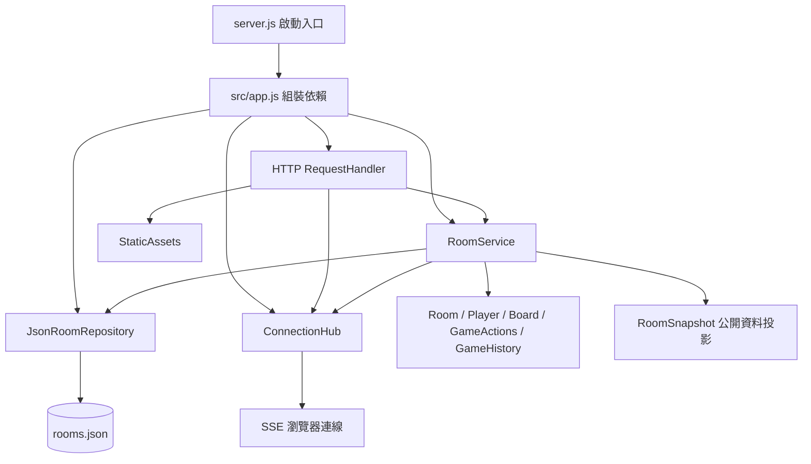
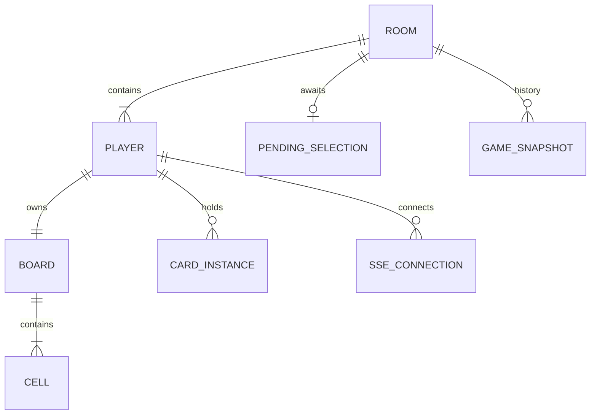
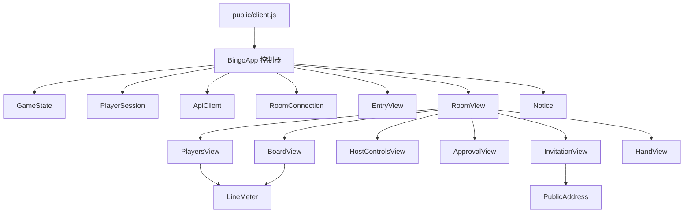

# Alberta Events 架構與物件關係

程式保留原本的 REST API、SSE 格式與 `data/rooms.json` 存檔格式。前端使用瀏覽器原生 ES modules，後端使用 CommonJS；不需建置工具或第三方套件。

## 後端：依賴方向

| 模組 | 職責 | 不負責的事 |
|---|---|---|
| `src/app.js` | 建立單一應用程式及其依賴，可注入測試用 repository | 遊戲規則 |
| `http/request-handler.js` | 路由、請求大小與來源檢查、HTTP 錯誤、SSE 生命週期 | 勝負與回合 |
| `application/room-service.js` | 組織加入／恢復身分、權限驗證、重送去重、執行規則後存檔並廣播 | 操作 DOM、直接讀寫檔案 |
| `application/room-snapshot.js` | 產生公開遊戲資料，排除憑證與操作紀錄 | 修改房間 |
| `domain/room.js`、`player.js` | 建立資料、玩家加入、身分驗證與加入順序 | HTTP 與檔案 |
| `domain/board.js` | 建立與驗證 N×N 盤面、控制每格覆蓋狀態、計算橫直斜連線 | 玩家身分與網路 |
| `domain/hand.js` | 建立獨立手牌陣列、加入／移除卡牌實例 | 卡牌效果、抽牌與出牌規則 |
| `domain/room-migration.js` | 為舊存檔補上格子狀態與手牌，保留既有覆蓋值 | 遊戲操作與存檔 IO |
| `domain/participants.js` | 區分房間成員與本局名單，準備階段恢復參與 | 刪除玩家、TCP 連線偵測 |
| `domain/game-actions.js` | 尺寸、準備、開始、選號、審核、略過、重開局 | 存檔與廣播 |
| `domain/game-history.js` | 建立快照、撤回、舊存檔回到開局的相容行為 | 玩家連線 |
| `infrastructure/json-room-repository.js` | 持有房間集合、讀檔、暫存檔替換寫入 | 遊戲規則 |
| `infrastructure/connection-hub.js` | 每位玩家的多條連線、在線狀態、心跳與事件傳送 | 持久化遊戲狀態 |

`RoomService` 只依賴 repository 的 `get/all/add/save` 和連線物件的 `isOnline/broadcast`，不綁定檔案系統。Domain 不匯入 HTTP、application 或 infrastructure。每次 `createApplication()` 都建立獨立依賴，測試不必共享全域房間集合。

## 遊戲資料關係

- `Room.players` 保存房間成員；`participantIds` 為掃描後本局參與的 UUID 清單，未設定時所有成員都參與。選號順序依 `Room.players` 原順序過濾本局名單，畫面排名只對副本排序，不能改寫此陣列。
- `scan` 只允許房主在 lobby 操作。斷線本身只變更 ConnectionHub 的在線狀態，仍保留玩家資料；明確按下掃描才從 `players` 刪除離線者。房主與在線玩家保留；同步清除歷史、roundStart 及舊版 archivedPlayers，避免殘留被刪除玩家引用。操作存檔並遞增 revision。
- `joinRoom()` 只會恢復仍在 `players` 的同 ID。被掃描刪除的 ID 再加入時建立全新 UUID、盤面及空手牌，舊憑證在重新加入前無法通過 API／SSE 驗證。無自動封存復原行為；開局後仍禁止新玩家加入。
- `Player.name` 是玩家輸入的房間內 ID；`Player.id` 是內部 UUID。`Room.host`、`Room.turn`、`pending.playerId`、`winners` 都參照 UUID，避免名字顯示與排名影響規則。
- `Player.token` 用於後續 API／SSE 驗證，只在建立或恢復該玩家時回傳。公開快照不包含它。
- `Player.board` 仍是數字排列，保留編輯 API 相容性；`Player.cells` 是同順序的 `{ number, isCovered: boolean }` 陣列。`isCovered=true` 表示被蓋住（綠色標記），不是隱藏數字。`coverNumber(cells, number, false)` 可解除單一格子，且不影響其他玩家。
- `Room.called` 是確認過的選號紀錄與禁止重複選號的依據，不是覆蓋狀態的唯一來源。`coveredLines(cells)` 和盤面樣式直接讀格子的 bool。舊 `lines(board, called)` 只保留為相容轉接函式。
- `pending` 尚未計分；房主確認後才把號碼加入 `called` 並蓋住所有人的對應格子。拒絕不修改格子。之後其他功能可以獨立修改某位玩家的格子狀態。
- `Player.hand` 是該玩家獨立持有的卡牌實例陣列，初始為空。`addToHand(player, cardData)` 產生唯一實例 ID 並加入，`removeFromHand(player, cardId)` 移除指定實例；兩者目前只供伺服器內部使用，不開放任意客戶端增減手牌。卡牌內容、數量上限、抽牌及出牌規則留待後續設計。
- REST 與 SSE 都依接收者產生快照：所有玩家可見 `handCount`，只有本人資料會包含 `hand`，房主也看不到別人的手牌內容。前端 `HandView` 永遠顯示自己手牌，不跟隨所查看的盤面切換。
- `GameSnapshot.playerStates` 保存每位玩家的格子及手牌深拷貝，撤回會還原，不包含憑證或在線狀態；開局另存 `roundStart` 供最早狀態復原。撤回舊歷史時若沒有 `playerStates`，以當時的選號紀錄推回格子；載入存檔時則只初始化缺少新欄位的舊玩家，不覆寫合法 bool。
- 新建或改尺寸會建立未蓋住的格子；重新開局會解除所有覆蓋並清空手牌。尺寸只能在 lobby 修改並清除歷史。後續若加入開局發牌，應在建立 `roundStart` 前完成。
- `Player.requests` 保留成功操作 ID；重送回傳現況，不重複修改。`Room.revision` 單調遞增，不隨撤回倒退。
- 在線狀態來自 `ConnectionHub`，不寫入存檔；同玩家任一分頁仍連線即視為在線。

## 前端：物件組合

- `BingoApp` 把使用者意圖轉成 API 操作，再把快照交給 `GameState`；它不產生玩家卡片或格子。
- `GameState` 持有伺服器快照及本地草稿、所查看玩家、忙碌／連線狀態。拒絕較舊 revision；尺寸版本更新才丟棄舊草稿。它不操作 DOM 或儲存空間。
- `PlayerSession` 封裝分頁身分與舊版 localStorage 遷移；`PublicAddress` 只管邀請網址。玩家憑證不混入分享連結。
- `ApiClient` 封裝逾時與重試，一次操作的 payload 和 requestId 只建立一次。
- `RoomConnection` 管理 SSE 與重連回呼。關閉或換房後，舊連線的延遲事件不能再改變新房間。
- View 只讀 state，透過注入的 action callbacks 回報選號、編輯、設定或切換玩家，不直接呼叫 API。`BoardView` 和 `PlayersView` 共用無狀態的 `lineMeter()`。
- `RoomView` 是畫面組合層；每個子元件管理自己的 DOM 區域與短暫顯示狀態，例如清單捲動位置或對話框。

## 一次選號的資料流

1. `BoardView` → `actions.call(number)` → `BingoApp` → `ApiClient`。
2. HTTP handler 解析請求，交給 `RoomService.execute()`。
3. Service 驗證玩家及重送識別碼，`GameActions` 檢查回合並建立 `pending`；`GameHistory` 保存前一狀態。
4. Repository 寫入存檔，Service 產生公開快照，ConnectionHub 廣播。
5. 每個瀏覽器的 RoomConnection 收到快照，GameState 接受較新狀態，RoomView 更新子元件。
6. 房主的 ApprovalView 顯示待確認號碼，確認／拒絕走相同資料流。

## 修改功能時的入口

獎品配置與得主由 `domain/line-prizes.js` 管理，`room.linePrizes` 為唯一權威紀錄。每個格子具有固定 ID、方向、位置、道具與唯一 `claimedBy`。房主確認號碼後，先更新所有格子的覆蓋狀態，再為未取得的獎品尋找第一位完成該線的玩家；同次完成時沿用房間加入順序。快照提供全房獎品得主及各玩家的 `rewards` 投影，前端 `LinePrizesView` 顯示歸屬，`RewardsView` 彙總道具數量。`GameHistory` 一併保存獎品池，撤回與重新開局不另行操作玩家背包，避免雙份紀錄失去同步。

卡牌使用經由 `CardPreviewView` → 注入的 `useCard` action → `RoomService` → `domain/card-actions.js`，在房間建立 `activeCard`。`room-snapshot.js` 投影公開卡片與問題，再由 SSE 廣播；`SharedCardView` 顯示全房相同的作答或結果視窗。`activeCard` 存在時 `game-actions.js` 拒絕其他遊戲操作，只接受作答、房主判定與結束。題庫以 `domain/card-catalog.js` 為準；作答後進入 `review`，只有房主可透過 `cardJudge` 提交布林判定值，才進入 `result`。對錯以房主決定為準，不比對示範題的預設答案。示範卡消耗紀錄保存於玩家的 `usedDemoCards`，不與正式手牌混用。`GameHistory` 以整次卡牌使用為單位還原。

- 調整連線與勝負：`domain/board.js`、`domain/game-actions.js`。
- 改變玩家清單、排序或捲動：`public/js/views/players-view.js`。
- 改盤面輸入與格子顯示：`public/js/views/board-view.js`。
- 調整 API 重試／SSE：`public/js/network/`。
- 更換持久儲存：新增 repository 並由 `src/app.js` 注入，保留 repository 合約。
- 新增操作：加入 domain handler，控制器提供 action，對應 View 綁定事件，再補行為測試。

目前仍為單程序 JSON 存檔架構。這次是職責拆分，沒有加入帳號密碼或多程序同步，也沒有改變「同房號＋同玩家 ID 即恢復原身分」的規則。

房主 approve 選號時，card-actions.drawForNumber 在相同操作內隨機選取卡牌定義並呼叫 addToHand 建立獨立 UUID；lastDecision.drawnCardId 只用於識別本次發牌，快照的 lastDraw 僅投影給選號者。HandView 使用卡片 UUID 呼叫 cardUse，伺服器驗證手牌歸屬後移除該實體，activeCard 仍參照題庫定義。DrawCardView 只播放伺服器發卡的動畫，不提供額外抽牌 API。
