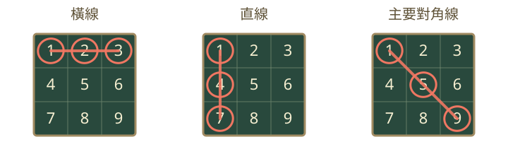
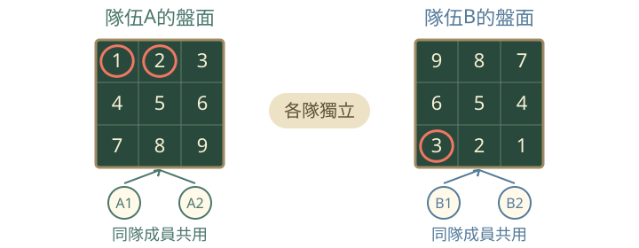
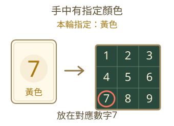
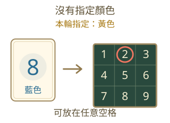
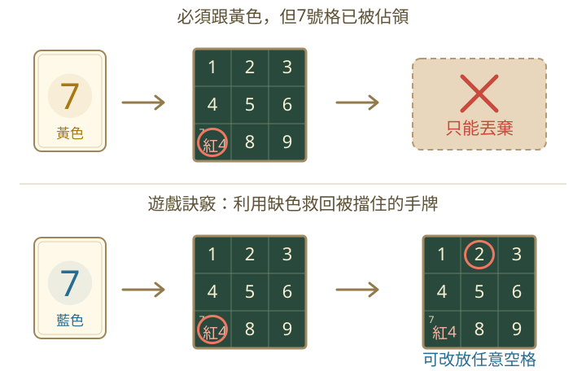

# 橋牌賓果 Bridge Bingo

和隊友合作，透過三色數字卡佔領格子，在自己隊伍的盤面完成賓果連線。

## 遊戲目標

完成 **「盤面邊長 − 2」條連線**，即可達到勝利門檻。本局需要幾條線，可在盤面上方查看。

完整的橫線、直線與兩條主要對角線都算連線，同一格可以同時計入多條線。

## 盤面與手牌

加入房間後，先選擇隊伍、確認自己隊伍的盤面，再按「準備好了」。所有玩家準備完成後，由房主開始並發牌。

- **每隊共用一張獨立盤面，各隊分別佔領自己的格子。** 各隊的數字排列與佔領進度互不影響。
- 盤面包含 1～盤面總格數，每個數字恰好出現一次。開始前可以與隊友一起安排自己隊伍的數字。
- 每張數字卡都有紅、黃、藍其中一種顏色。整套卡牌的三色張數盡量平均，最多相差一張。
- 所有隊伍使用相同的數字與顏色對應，但各隊獨立洗牌、平均發牌；每位玩家手上的三色張數不一定平均。
- **只能查看自己的手牌。可以討論策略，但不能直接透露確切手牌或展示給隊友。**

可以這樣討論：「我希望這輪出黃色」、「我可能可以幫忙完成左邊那條線」。

不能直接說：「我有黃色7」、「我的牌是3、8、12」。

### 出牌順序

1. 每人每輪出一張牌，手牌已空的玩家自動略過。
2. 第一隊全員完成後，再換下一隊，依隊伍順序進行。
3. 隊內依加入順序出牌，每輪首位玩家向後輪替一人。
4. 所有隊伍完成同一輪後，一起判定勝負；若尚未結束，再開始下一輪。

例如同隊順序是 A、B、C：

| 輪次 | 隊內出牌順序 |
| --- | --- |
| 第一輪 | A → B → C |
| 第二輪 | B → C → A |
| 第三輪 | C → A → B |
| 第四輪 | A → B → C |

## 跟色與放置

每輪由該隊首位玩家打出的卡片顏色，決定該隊本輪的 **指定顏色**。每隊各自決定指定顏色，新的一輪重新決定。

| 你的情況 | 可以出的卡片 | 可以放置的位置 |
| --- | --- | --- |
| 首位玩家 | 任意顏色 | 卡片數字對應的空格 |
| 後續玩家持有指定顏色 | 必須出指定顏色 | 卡片數字對應的空格 |
| 後續玩家沒有指定顏色 | 任意顏色 | 任意尚未佔領的空格 |

**首位玩家尚無指定顏色，因此沒有缺色的情況。**

### 持有指定顏色

本輪指定黃色，若你手中有黃色卡片，就必須出黃色。打出黃色7時，必須放在7號空格。

### 沒有指定顏色

本輪指定黃色，若你手中沒有黃色卡片，就可以出其他顏色。例如打出藍色8，放在2號空格。

已佔領的格子不能覆蓋，已使用的卡片不能移動或再次使用。放在其他數字格的卡片，仍以實際佔領的位置計算連線。

## 只能丟棄的情況

- **首位玩家：**若所選卡片的對應格已被佔領，只能丟棄該牌；這張牌的顏色仍會成為本輪指定顏色。
- **後續玩家持有指定顏色：**必須出該色卡片；若所選卡片的對應格已被佔領，則需棄牌。即使另有可正常放置的同色牌，也可以選擇棄掉這張被擋住的牌。

例如你必須跟黃色，但黃色7的7號格已被其他卡片佔領，就只能丟棄黃色7，不能改放其他空格。

> **遊戲訣竅：利用缺色可以救回對應格已被佔領的手牌。**
>
> 後續玩家若沒有指定顏色，即使所出卡片的對應格已被佔領，仍可改放任意尚未佔領的空格。此時應放置卡片，不能選擇棄牌。

## 如何操作

1. 輪到你時，點選「我的手牌」中的卡片。
2. 確認使用後，點選盤面亮起的空格，完成放置。
3. 標示「只能丟棄」的卡片，確認後即棄牌並換下一位，不需要再點盤面。

取消確認不消耗卡片；正式放置或丟棄後才消耗卡片。若卡片目前不能使用，點選後會顯示原因。

### 勝負結算

**所有隊伍完成同一輪後，一起判定勝負。同輪達標的隊伍並列獲勝。**

- 某隊先達標時，其他隊伍仍可完成該輪。
- 全部手牌用完也會結束；若沒有隊伍達到勝利門檻，則無勝者。
- 結束後可關閉結果視窗，繼續查看各隊盤面。

遊戲中若斷線，使用相同房號與玩家ID重新加入，即可恢復原本的手牌與出牌進度。
